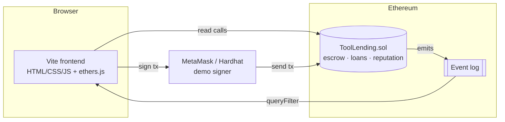
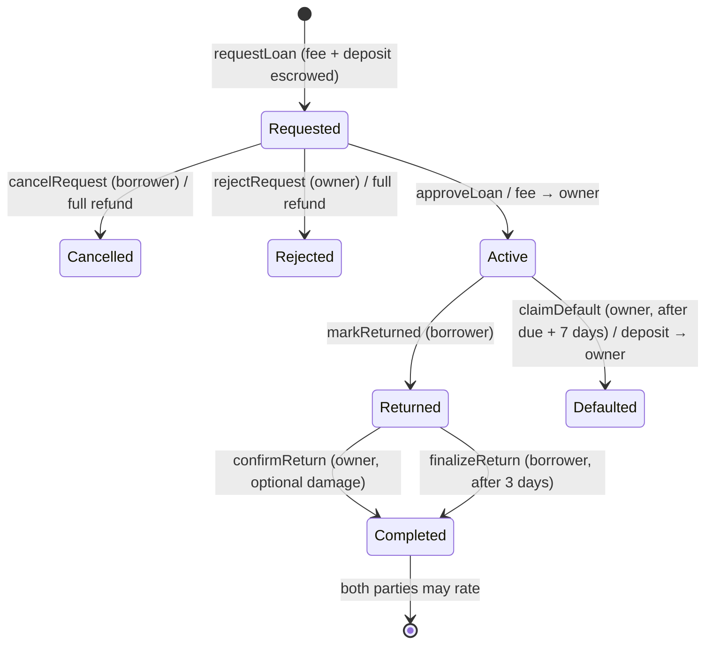

# The Toolshed — Neighbourhood Tool Lending on Ethereum

A decentralised application (DApp) that lets neighbours lend and borrow tools without having to trust each other or a middleman. A Solidity smart contract holds each borrower's security deposit in escrow, calculates late fees automatically, settles disputes with time-outs, and records every member's reputation permanently on-chain.

   

---

## Why blockchain?

| Problem in a normal tool-sharing group | How the contract solves it |
| --- | --- |
| "Will I get my drill back?" | Borrower locks a deposit in the contract before receiving the tool. |
| "Will I get my deposit back?" | Neither party holds the money — the contract refunds it by fixed rules. |
| Late returns cause arguments | Late fee is computed from block timestamps, not opinions. |
| Owner ghosts after return | Borrower can self-refund after a 3-day confirmation window. |
| Borrower never returns | Owner can claim the deposit after a 7-day grace period. |
| Fake reviews, deleted history | Ratings and loan history are immutable events on the ledger. |

## Features

- **Membership:** neighbours register with a name and street/block.
- **Tool catalogue:** list tools with a daily fee (or free) and a refundable deposit; edit or unlist them.
- **Escrowed borrowing:** fee + deposit are paid into the contract when requesting; the owner approves or rejects.
- **Automatic settlement:** the late fee is 2× the daily fee per overdue day (10% of the deposit for free tools), capped at the deposit, and the owner can make an optional damage claim.
- **Dispute timeouts:** the borrower can self-finalise if the owner doesn't confirm the return, and the owner can claim a default if the tool isn't returned.
- **Reputation:** two-way 1–5 star ratings plus counts of completed loans, damage reports and defaults.
- **Pull payments:** all payouts are credited to an internal balance and withdrawn by the member, which protects against re-entrancy.
- **Live ledger:** the frontend reads contract events and shows a block-by-block activity feed.
- **Demo mode:** switch between local Hardhat accounts in one click, and fast-forward chain time to demo late fees.

## Architecture



### Loan lifecycle (state machine)



## Project structure

```
neighbourhood-tool-lending/
├── contracts/ToolLending.sol     # Smart contract
├── test/ToolLending.test.js      # 26 unit tests (Mocha + Chai + Hardhat)
├── scripts/deploy.js             # Deploys and writes ABI + address for the frontend
├── scripts/seed.js               # Demo members, tools and loans
├── frontend/                     # Vite web app (index.html, src/main.js, src/style.css)
├── docs/PROJECT_REPORT.md        # Academic project report
└── hardhat.config.js
```

## Getting started

**Prerequisites:** Node.js 18+ and npm. MetaMask is optional, because the app has a built-in demo-account picker for the local chain.

```bash
npm install
npm test                 # compile + run the test suite
```

Run the full DApp locally (three terminals):

```bash
npm run node             # 1. local blockchain at http://127.0.0.1:8545
npm run deploy:local     # 2. deploy contract (writes frontend/src/deployment.json)
npm run seed:local       #    optional: demo neighbours, tools and loans
npm run dev              # 3. frontend at http://localhost:5173
```

> Restarting `npm run node` wipes the chain. Run `deploy:local` (and `seed:local`) again afterwards.

### Demo walkthrough

1. Open http://localhost:5173 and pick **#3 Priya Nair** from the *Demo account* menu.
2. **Browse:** borrow the *Extension Ladder* for 2 days. The modal shows the fee and deposit being locked.
3. Switch to **#1 Asha Kulkarni**, then go to **My Shed** and approve the request.
4. Click **+7 days** in the footer to move chain time forward. The loan is now overdue.
5. Switch back to Priya, then go to **Borrowing** and click **I've returned it**.
6. As Asha, click **Inspect & confirm return**. The late fee is calculated automatically.
7. Both parties rate each other. Then open **Profile & Wallet** and withdraw the balance.
8. Open the **Ledger** tab to see every step as an on-chain event with its block number and transaction hash.

### Using MetaMask with the local chain

Add a network with RPC `http://127.0.0.1:8545` and chain ID `31337`. Then import one of the private keys printed by `npm run node`. If you restart the node, open MetaMask → Settings → Advanced → **Clear activity tab data** to reset nonces.

### Deploying to Sepolia testnet

```bash
cp .env.example .env     # fill SEPOLIA_RPC_URL and DEPLOYER_PRIVATE_KEY (test wallet only!)
npm run deploy:sepolia
npm run build            # static site in frontend/dist, deployable to any static host
```

## Smart contract API

| Function | Who | Purpose |
| --- | --- | --- |
| `registerMember(name, neighbourhood)` | anyone | Join the system |
| `listTool(name, category, description, dailyFee, deposit)` | member | Add a tool |
| `updateTool(toolId, dailyFee, deposit, listed)` | owner | Reprice / unlist (not while on loan) |
| `requestLoan(toolId, days)` *payable* | member | Escrow `dailyFee × days + deposit` |
| `cancelRequest(loanId)` / `rejectRequest(loanId)` | borrower / owner | Full refund |
| `approveLoan(loanId)` | owner | Start the loan; fee released to owner |
| `markReturned(loanId)` | borrower | Declare the tool returned |
| `confirmReturn(loanId, damageCharge)` | owner | Settle: late fee + damage to owner, rest refunded |
| `finalizeReturn(loanId)` | borrower | Self-settle after 3-day window |
| `claimDefault(loanId)` | owner | Take deposit after due + 7 days |
| `rate(loanId, score)` | either party | 1–5 stars, once each |
| `withdraw()` | anyone | Pull credited ETH |

The contract also has view functions: `getAllTools`, `getTool`, `getToolsByOwner`, `getLoan`, `getLoansByBorrower`, `getLoansByLender`, `getMember`, `getMembers`, `reputationOf`, `previewLateFee` and `pendingWithdrawals`.

## Security considerations

- **Checks-effects-interactions and pull payments:** ETH leaves the contract only in `withdraw()`, which is protected by OpenZeppelin's `ReentrancyGuard`.
- **Exact payment:** `requestLoan` uses `require` so `msg.value` must equal the amount returned by the `pure` function `quote`.
- **Bounded charges:** the late fee plus the damage charge can never exceed the deposit.
- **Role checks:** every state transition verifies the caller (borrower or lender) and the current loan status.
- **Custom errors:** these give cheaper reverts with clear reasons, and the frontend decodes them into readable messages.
- **No admin keys:** there is no owner, no pause switch and no upgradeability. The rules cannot be changed after deployment.

## License

MIT
